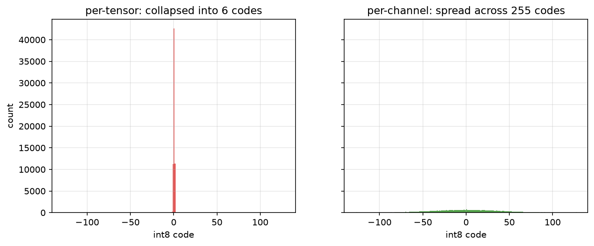
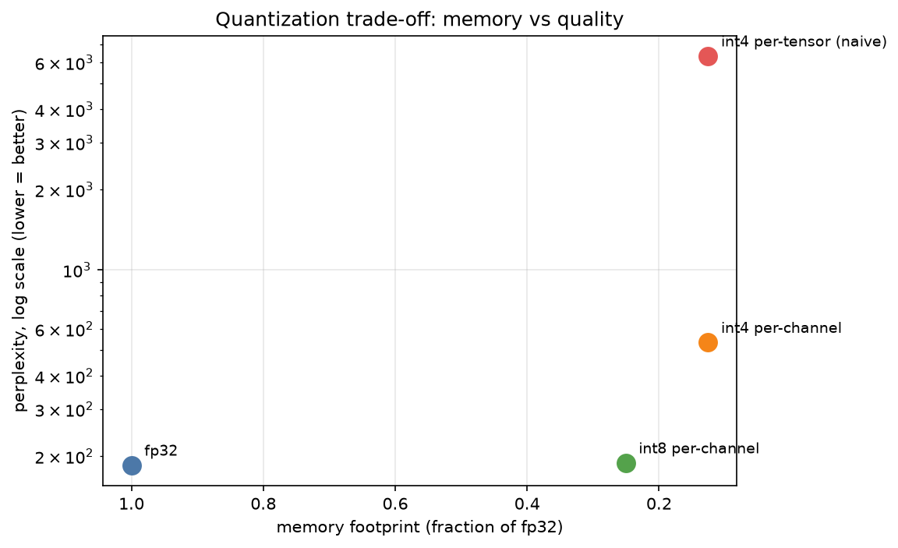

# quantization_101

### You can throw away three quarters of every number and barely notice.

A hands-on, build-it-from-scratch introduction to **model quantization** — the technique
that shrinks a model to a quarter of its size so it runs on a laptop instead of a
datacenter. Everything here runs on **CPU** inside a 2-CPU / 8 GB GitHub Codespace, with
no GPU.


Quantization usually arrives as a magic flag (`load_in_4bit=True`) that hides a simple,
instructive idea: a 32-bit float stores far more precision than a model's behavior needs.
Map those floats onto a small grid of integers — 256 levels for int8, 16 for int4 — and
most of the discarded precision turns out not to matter. This repo builds that operation
in a few lines of numpy, measures exactly what it costs, and shows the one place it breaks.

**The lesson is two-sided and exact:** most of the precision in a model is genuinely wasted
— but the small fraction that is not, the **outliers**, will destroy a naive quantizer. A
single weight ten times larger than the rest stretches the scale so far that every ordinary
weight collapses into a couple of buckets. Telling those two apart — per-channel scales,
outlier handling, measuring what you changed — is the entire art of modern quantization.

---

## What the code proves (measured, not asserted)

Every number below is produced and saved by a notebook into [`outputs/`](outputs/); the
assertions are enforced by the test suite.

| Claim | Measured result | Source |
|---|---|---|
| int8 cuts storage to a **quarter**, int4 to an **eighth** | `0.25×` / `0.125×` — *asserted* | nb 02 · `test_size` |
| int8 reconstruction error is tiny | **1.3%** relative error on a real `distilgpt2` matrix | nb 02 |
| int8 barely moves behavior | logit cosine **0.99990**; perplexity **188.5 vs 184.8** (fp32) | nb 02 · 05 |
| one outlier collapses per-tensor quantization | ordinary weights crushed into **6 of 256** codes → **16× worse** error — *asserted* | nb 03 · `test_outlier` |
| per-channel scales recover the quality | error restored; **255 of 256** codes used again — *asserted* | nb 03 · `test_outlier` |
| clipping tames the extremes | error **21.5% → 1.0%** | nb 04 |
| activations are harder than weights | per-row error **18.4%** (activation) vs **1.7%** (weight) | nb 04 |
| int4 needs good granularity | per-channel perplexity **534** vs naive per-tensor **6341** | nb 05 |
| the from-scratch path matches a reference | agrees with torch's int8 quantizer to within one quantization level | nb 05 · `test_quant_roundtrip` |

<p align="center">
  <br>
  <em>One outlier, per-tensor (left): the ordinary weights collapse into 6 distinct int8 codes.
  Per-channel (right): they keep 255. Same 8 bits — the scale was hijacked, not the precision.</em>
</p>

<p align="center">
  <br>
  <em>The whole trade-off: fp32 and int8 sit together at good quality; int4 per-channel buys more
  memory at a real cost; int4 <strong>naive</strong> per-tensor is dominated — same memory, far worse.</em>
</p>

---

## Quickstart

```bash
make setup      # install deps with uv + register the Jupyter kernel
make test       # run the test suite (17 tests)
make notebooks  # execute all six notebooks in place (~85s on 2 CPUs)
make run        # launch the Streamlit app on :8501
make lint       # ruff format + ruff check + ty
make ci         # sync + lint + test (what CI runs)
```

Requires [`uv`](https://docs.astral.sh/uv/) (installed automatically by `make setup`). The
first run downloads `distilgpt2` (~330 MB) and caches it. No GPU, no `pip`, no `conda`.

---

## The notebooks

A linear build-up — each notebook earns the next. Figures land in
[`outputs/figures/`](outputs/figures/), numeric results in
[`outputs/data/`](outputs/data/).

| # | Notebook | What it shows |
|---|---|---|
| 01 | [Precision You Don't Need](notebooks/01_precision_you_dont_need.ipynb) | A real weight matrix is smooth and bounded; rounding it to 256 levels barely moves it. Precision is reducible. |
| 02 | [Quantize From Scratch](notebooks/02_quantize_from_scratch.ipynb) | **The showpiece.** Absmax & zero-point in a few lines, the exact size cut, and the model's next-token prediction unchanged at int8. |
| 03 | [The Outlier Problem](notebooks/03_the_outlier_problem.ipynb) | **The honest crux.** A planted outlier collapses the ordinary weights under per-tensor quantization — a measured fact, the same failure as a feature scaler. |
| 04 | [Granularity and Schemes](notebooks/04_granularity_and_schemes.ipynb) | The fixes: per-channel scales, clipping's sweet spot, absmax vs zero-point, and why activations are harder. |
| 05 | [End to End on a Model](notebooks/05_end_to_end_on_a_model.ipynb) | Quantize all of `distilgpt2`: quality (logit cosine, perplexity), memory, reference validation. int8 nearly free; int4 needs care. |
| 06 | [Decision Framework](notebooks/06_decision_framework.ipynb) | Consolidates every prior result into defaults you can apply, and the memory-vs-quality trade-off in one figure. |

---

## The library (`src/`)

The quantizers are written from scratch in **numpy**, so the scale and the rounding stay
visible. Library quantizers (`bitsandbytes`, torch's own) appear only under
[`src/reference/`](src/reference/) — as something to validate *against*.

```
src/
  quant/        absmax (symmetric) · zeropoint (asymmetric) · granularity
                (per-tensor vs per-channel) · outliers (clip / isolate) · dequant
  bits/         int8 / int4 packing + the size math (1/4, 1/8)
  models/       real distilgpt2 weight matrices · planted-outlier synthetics · a TinyMLP for tests
  evaluation/   reconstruction error · downstream quality · size/speed · the arena
  reference/    cross-check the from-scratch path against torch's int8 quantizer
  artifacts.py  save every figure as PNG and every result as JSON
  visualisation.py · config.py
```

Core API:

```python
from src.quant.granularity import quantize
from src.quant.dequant import dequantize

qa   = quantize(weights, bits=8, scheme="absmax", granularity="per_channel", axis=1)
back = dequantize(qa)          # qa stores int codes + one scale per row
qa.nbytes                      # computed footprint, not asserted
```

---

## The Streamlit app

`make run` opens four interactive views: **quantize a matrix** (pick bit-width and scheme,
see the buckets and error), the **outlier breaker** (inject an outlier, watch per-tensor
collapse then switch to per-channel), the **bit-width trade-off** sweep, and a **scheme
comparison**.

---

## Part of a series

This is the quantization half of **QLoRA**. It cross-links four sibling projects by
[Dima806](https://github.com/Dima806):

- **[lora_101](https://github.com/Dima806/lora_101)** — low-rank adaptation, the technique
  that made fine-tuning large models affordable, from scratch on CPU. *QLoRA = quantization
  (this repo) + LoRA.*
- **[transformers_101](https://github.com/Dima806/transformers_101)** — the architecture
  behind every LLM, built from scratch in numpy at toy scale. *The linear layers we quantize
  are its weight matrices.*
- **[scaling_arena](https://github.com/Dima806/scaling_arena)** — a head-to-head comparison
  of feature-scaling strategies on data with planted outliers. *The outlier-wrecks-the-scale
  failure, in a different setting.*
- **[information_theory_101](https://github.com/Dima806/information_theory_101)** — entropy,
  cross-entropy, and mutual information. *Bits as the unit of information, and how few you
  actually need.*

---

## Technical constraints

Python 3.11+ · `uv` · `torch` (CPU) + `transformers` for the model and weights · `numpy`
for the from-scratch quantizers · `onnxruntime` optional. Each notebook runs in under six
minutes on 2 CPUs; a small model in fp32 plus its quantized copies fits in 8 GB.

## References

- Dettmers et al. (2022), *LLM.int8(): 8-bit Matrix Multiplication for Transformers at Scale* — outlier features.
- Frantar et al. (2023), *GPTQ: Accurate Post-Training Quantization for Generative Pre-trained Transformers.*
- Lin et al. (2024), *AWQ: Activation-aware Weight Quantization.*
- Dettmers et al. (2023), *QLoRA: Efficient Finetuning of Quantized LLMs.*
- Nagel et al. (2021), *A White Paper on Neural Network Quantization* (Qualcomm AI Research).

## License

[Apache-2.0](LICENSE).
